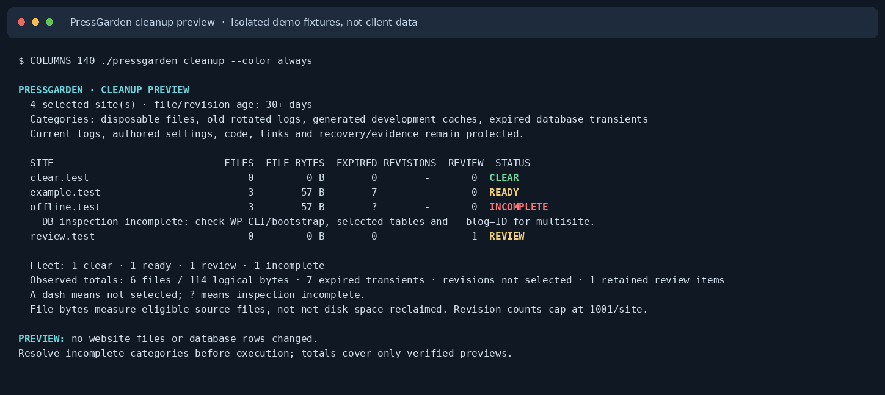

# PressGarden

<p align="center">
  
</p>

**Maintain WordPress from the shell, one installation or a fleet at a time.**
PressGarden previews routine cleanup, checks database health, and manages an
existing LiteSpeed Cache installation. It shows the selected scope and measured
results, with backups and confirmations for the operations that require them.

PressGarden is a standalone MIT-licensed Linux/Bash/PHP application. It contains its own discovery, targeting, lifecycle and relevant operation code. Neither sibling repository is required. It is not a wrapper around PressWarden.

## Other Press tools

PressGarden is part of the **Press Tool Family**. Other standalone tools are available for related WordPress administration tasks:

- **[PressWarden](https://github.com/marketania/PressWarden)** — WordPress security auditing, malware and vulnerability detection, compromise investigation, integrity checks, and incident response.
- **[PressHarden](https://github.com/marketania/PressHarden)** — WordPress hardening, security policy, `wp-config.php` controls, PHP posture, locking, and update preferences.

Use PressGarden for maintenance. It has no malware scanner, threat feeds,
quarantine, or incident-remediation workflow, and does not install or activate
caching plugins automatically.

## Which version does this guide describe?

This guide describes **PressGarden 0.1.2**, including unified cleanup selectors,
the colored fleet display, and grouped help. See the
[0.1.2 release notes](docs/releases/0.1.2.md) for the changes. Existing users can
follow [Update and uninstall](#update-and-uninstall), then check
`./pressgarden version` and `./pressgarden help`.

Keep track of the source checkout or archive you installed. See
[Releases](https://github.com/marketania/PressGarden/releases) for published
archives and their checksums, source metadata, and release notes. Older releases
have their own bundled help and README.

## Install a selected distribution

You need:

- Linux, Bash 4+, PHP CLI with zlib, and the usual GNU coreutils, `find`, and `tar`.
  The code retains PHP 7.4 syntax compatibility; run a currently
  [supported, security-patched PHP release](https://www.php.net/supported-versions.php).
- WP-CLI for WordPress/database operations, and its MySQL/MariaDB client tools
  for SQL exports. Filesystem-only cleanup can run without WP-CLI.
- `flock` for protected operations. LiteSpeed features additionally need an
  already installed, active LiteSpeed Cache plugin.

Run as the account that owns the sites. Choose an installation directory
**outside every served website directory**; private backups will live there by
default in a portable installation. Start with one staging installation and
review the [public-readiness and rollout checklist](docs/PUBLIC-READINESS.md)
before fleet use.

**Recommended: install from the local distribution you deliberately selected.**
Download `PressGarden-0.1.2.tar.gz`, `SHA256SUMS`, and `SOURCE.json` from the
[v0.1.2 release](https://github.com/marketania/PressGarden/releases/tag/v0.1.2).
Verify the archive against the checksums, extract it, and review its source and
`install.sh`. From the extracted directory containing `PRODUCT`, `pressgarden`,
and `install.sh`:

```bash
PRESSGARDEN_INSTALL_SOURCE="$PWD" \
PRESSGARDEN_INSTALL_PREFIX="$HOME/tools/PressGarden" \
bash ./install.sh

cd "$HOME/tools/PressGarden"
./pressgarden version
./pressgarden help
```

The destination must not already exist. The installer copies the selected source,
validates it, and creates a separate portable installation with a private config.
It does not overwrite an existing installation or download a sibling tool.

The alternative source shortcut is `curl -fsSLo install.sh https://raw.githubusercontent.com/marketania/PressGarden/main/install.sh` followed by `bash install.sh`.
That shortcut fetches the moving **`main` branch**. Download it into a fresh
working directory, rather than overwriting an installer in a checkout you are
reviewing. Use the selected-distribution method above to install a specific release.
The portable local-source path above is the recommended path for this guide.

## Choose your sites and configuration

A website name selects a **local WordPress directory**. PressGarden does not SSH
into another host or contact a website to resolve that name.

```bash
./pressgarden config
./pressgarden sites /home/account/domains
```

`config` shows the effective scan root and private paths. `sites` lists discovered
names and directories without changing the saved root. Set the intended fleet
root in the installed `config/config` before relying on omitted targets:

```bash
PRESSGARDEN_SCAN_ROOT="/home/account/domains"
PRESSGARDEN_INTERACTIVE=1
# Optional: exclude these exact sites or nested installations.
PRESSGARDEN_EXCLUDE="retired.example.com example.com/staging"
```

Edit the existing file rather than replacing it with the template. Configuration
is trusted shell code: keep it owned by the administrator/site account and mode
`600`. Exported `PRESSGARDEN_*` values override saved settings for a command.
`config-new` only compares available option names; it does not create or rewrite
configuration and can be used when the saved file has broken shell syntax.
See [config/config.example](config/config.example) for available settings.

| Target | Scope |
|---|---|
| `example.com` | The matching installation **and its discovered nested installations** |
| `example.com/shop` | That nested installation and any discovered children |
| `/absolute/path/to/wordpress` | Installations discovered under that explicit directory |
| `all`, or no target | The configured/default fleet root |

Use one positional target, or `--target SITE` for maintenance commands. `sites`
accepts an optional directory. Always read its mappings first: a parent domain
is not necessarily one WordPress installation. An empty, unknown, excluded,
ambiguous, or invalid target fails instead of selecting the fleet. If you have
not configured a root, common hosting folders are inferred; inspect `config`
and set an explicit root before fleet operations.

Custom hosting paths, aliases, exclusions, and URL-like target syntax are covered
in [site targeting](docs/SITE-TARGETS.md).

## First-site walkthrough

Replace the path below with one staging WordPress directory. Check the discovered
scope, dependencies, and preview before applying anything:

```bash
./pressgarden sites /absolute/path/to/staging-wordpress
./pressgarden doctor /absolute/path/to/staging-wordpress
./pressgarden status /absolute/path/to/staging-wordpress
./pressgarden cleanup --verbose /absolute/path/to/staging-wordpress
```

`doctor` diagnoses local prerequisites and discovery. A zero-site result is
incomplete. `status` inventories themes, the object-cache drop-in, and available
LiteSpeed database counters. `cleanup` is a preview: it does not change website
files or database rows, although private toolkit state/discovery caches may be
written. Database previews bootstrap trusted WordPress code.

If WP-CLI is unavailable and you want to inspect only files, select those
categories explicitly:

```bash
./pressgarden cleanup -files -logs -development --verbose /absolute/path/to/staging-wordpress
```

Resolve `INCOMPLETE` and inspect `REVIEW` items first. Check the backup location
and your recovery plan. When the complete preview covers the intended scope,
request execution and then inspect again:

```bash
./pressgarden cleanup --execute /absolute/path/to/staging-wordpress
./pressgarden cleanup /absolute/path/to/staging-wordpress
```

Keep any category filters from your preview when executing. `--execute` requests
the operation; it does not automatically answer interactive confirmations.
Database and file cleanup have their own backup/confirmation steps. A later
failure or cancellation can leave earlier categories completed; recovery paths
are printed and no cross-category transaction is promised.

## Everyday commands

These examples use names already listed by `sites`.

| What you need | Command | Behavior |
|---|---|---|
| Maintenance overview | `./pressgarden status example.com` | Read-only inventory |
| Database inventory | `./pressgarden status -db example.com` | Selected table engines and allocation estimates |
| Database health check | `./pressgarden check -db example.com` | Explicit CHECK; no repair or optimization |
| Routine cleanup preview | `./pressgarden cleanup example.com` | All routine categories; no deletion |
| Cache configuration | `./pressgarden status -cache example.com` | Existing LiteSpeed configured state |
| Explicit cache purge | `./pressgarden cache clear example.com` | Confirmation; multisite needs explicit scope |
| Diagnose setup | `./pressgarden doctor --target example.com` | Dependency and discovery checks |
| Focused help | `./pressgarden help cleanup` | Examples and options for one task |

Use `help db`, `help cache`, or `help status` for those topics; `help all` lists
advanced commands. Command `--help` never dispatches maintenance or an update.
Existing `db` and `litespeed` commands remain available.

## Cleanup selectors and defaults

Without category flags, `cleanup` previews **all four supported routine
categories**. A selector narrows the request; selectors can be combined and
accept one or two dashes.

| Selector | Eligible category |
|---|---|
| `-files` / `--files` | Old disposable filesystem metadata |
| `-logs` / `--logs` | Old rotated logs; current logs remain protected |
| `-development` / `--development` | Recognized generated development caches |
| `-db` / `--db` | Expired database transients through WP-CLI |

For example, `cleanup -files -logs example.com` excludes database and development
cleanup. Use `--verbose` for bounded candidate paths and retained review details.
`cleanup preview` and `cleanup status` also remain read-only; `cleanup execute`
is the explicit action form of `--execute`. Conflicting preview/execute requests
are rejected.

Files and explicitly selected revisions have a default minimum age of 30 days;
`--older-than=60` changes that age. Expired transients follow their stored expiry
timestamps. Revision deletion additionally requires `--revisions`. If category
flags are present, `--revisions`, `--blog=ID`, and `--tables=...` require `-db`.
Repair, table optimization, cache purges, and all-transient deletion are separate
requests and never implicit routine cleanup.

Current logs, application code, authored project settings, links, and named
backup/evidence directories stay protected. A zero-candidate preview means
nothing met the selected eligibility rules; it is not a malware verdict.
[Cleanup safety and recovery](docs/CLEANUP-SAFETY.md) explains file limits,
retained review items, snapshot checks, and backup manifests. Scripts that
previously used `cleanup` for metadata alone should now use `cleanup --files`.

## Read the results

| Cleanup status | Meaning |
|---|---|
| **CLEAR** | The selected categories were inspected and no eligible cleanup was found |
| **READY** | Eligible items were found; preview has not deleted them |
| **REVIEW** | Preserved items need inspection; execution is blocked until resolved |
| **INCOMPLETE** | A selected dependency, scan, or response could not be verified |

A dash means that category was not selected; `?` means a selected measurement is
unavailable. Missing WP-CLI does not mean the database is clean. Totals cover
verified previews only. File bytes are logical source bytes, **not net disk
space reclaimed**, because recovery copies are retained. Revision candidate
counts are bounded; one execution deletes at most 1,000 eligible revisions per
installation.

Color is automatic on terminal stdout. Redirected output stays plain.
`--color=auto|always|never`, `--no-color`, and `NO_COLOR` control presentation;
`NO_COLOR`/`PRESSGARDEN_NOCOLOR` take precedence even over explicit color requests,
and `TERM=dumb` disables automatic color. Status words remain readable without
color. Narrow terminals and long labels use two-line rows with full site names;
wide terminals retain the table. `COLUMNS` can set the display width explicitly.

This capture uses reserved-domain fixtures, including an intentionally
unavailable provider. It contains no client-site results.



### Exit codes

| Code | Meaning |
|---|---|
| `0` | The requested inspection/operation completed, including a successful preview or no eligible change |
| `1` | Review/partial result or declined confirmation, as stated by the command |
| `2` or higher | Invalid request, incomplete discovery/verification, dependency or execution failure, or interruption |

A preview can return `0` with `READY` items: nothing was applied. Advanced
provider `COMMAND COMPLETED` means the command succeeded; it does not prove
cache effectiveness or independently verified service changes.

## Database operations

Native `db` commands operate on WordPress-registered tables by default. Additional
`--tables=NAME,...` selections must belong to the selected installation. Multisite
requires `--blog=ID`; native per-blog operations exclude network/global tables.
Changed table plans or database identity are refused. `db check` never repairs;
`db repair` skips healthy tables and supports only eligible storage engines,
without inventing an InnoDB repair procedure. `db optimize` checks before and
after optimization. Use `help db` for the explicit actions.

Native database writes require private, checksummed SQL exports. Native exports
are table-scoped except when revision deletion is requested; revision deletion
and LiteSpeed database operations use a whole configured-database export, which
can include other sites or unrelated shared-database data. Keep enough private
disk space and protect these dumps. Checksums are not a restore test, and
nontransactional tables may require a host snapshot for consistency.

The [isolated database recovery drill](docs/DATABASE-RECOVERY.md) tests recovery
on disposable fixtures. It does not certify your own backup. Review the
[refinement checkpoint](docs/REFINEMENT.md) for scope and identity boundaries,
and [LiteSpeed database maintenance](docs/LITESPEED-DATABASE.md) for the distinct
provider counter/verification workflow.

## LiteSpeed and cache providers

The cache adapter supports **LiteSpeed only**. Missing/inactive providers are
reported as unavailable, never installed or activated. `status -cache` reads
configuration; a setting or object-cache file does not prove an HTTP cache HIT,
a working Redis connection, or a performance improvement.

For multisite cache purges, use `cache clear --blog=ID` for one active blog or
`cache clear --network` for the whole selected network. An unscoped multisite
purge is refused. This is separate from native database blog/table selection.
Advanced option, purge, preset, image, online/CDN, debug, crawler, and database
commands are documented in [LiteSpeed management](docs/LITESPEED.md).
External services and support uploads are contacted only by explicit commands;
those commands have additional privacy/destructive-action opt-ins.

## State, recovery, and troubleshooting

Portable installations keep private configuration in `config/config` and state,
backups, cache, and reports under `var/`. User installations use product-specific
XDG config/state/cache directories with standard home-directory fallbacks.
`config` shows effective paths. Overrides include `PRESSGARDEN_CONFIG_FILE`,
`PRESSGARDEN_STATE_DIR`, `PRESSGARDEN_CACHE_DIR`, and `PRESSGARDEN_REPORTS_DIR`.
No `PRESSWARDEN_*` compatibility variables are consumed.

State/backups must stay outside website roots. Cleanup recovery copies and their
manifests live under `state/backups/file-cleanup/`; SQL exports live under
`state/backups/database/`, where `state` means the effective state directory.
Backups are never automatically pruned. After interruption, inspect the manifest,
source files, and recovery copies before retrying or restoring; do not overwrite
newer site data blindly. See [cleanup recovery](docs/CLEANUP-SAFETY.md).

| Symptom | What to check |
|---|---|
| No installations found | Run `config` and `sites`; check the root, structural WordPress files, discovery depth, and exclusions |
| Unknown or ambiguous website | Use the exact mapping from `sites`, a deliberate absolute directory, or a private alias in [site targeting](docs/SITE-TARGETS.md) |
| Database preview is incomplete | Run `doctor`; verify WP-CLI/bootstrap and native `--blog=ID`/table scope, or explicitly select only file categories |
| Invalid saved shell config | Fix the syntax before rerunning; `config-new` can inspect option names without sourcing it |
| Backup or writer-lock failure | Check private storage, free space, ownership, and other running maintenance; stop concurrent writers before retrying |
| Update/recovery lock present | Follow [update recovery](docs/UPDATING.md); do not delete the lock blindly |

Keep confirmations enabled while learning the tool. `PRESSGARDEN_INTERACTIVE=0`
is explicit authorization for intentional unattended work; it does not bypass
backups or verification. WP-CLI executes trusted WordPress code, including
MU-plugins even when ordinary plugins are skipped. Investigate a suspected
compromise before maintenance. Operation locks are product-specific and do not
coordinate every external writer or sibling tool.

## Update and uninstall

Finish other operations, then run these commands from your installed PressGarden
directory:

```bash
./pressgarden update
./pressgarden version
./pressgarden config-new
```

The updater preserves private configuration and state. `config-new` previews any
missing configuration options for you to review.

Without an override, the updater follows moving `main`. To select this release
explicitly, use `PRESSGARDEN_REF=v0.1.2 ./pressgarden update`. Git checkouts are
refused by the program updater; maintain them through Git review. The updater
retains a program recovery backup. See [update and recovery details](docs/UPDATING.md).

`./pressgarden update` targets `marketania/PressGarden`, never a sibling and never threat feeds. For isolated validation or recovery, test/update with a local validated distribution archive:

```bash
PRESSGARDEN_UPDATE_ARCHIVE=/absolute/path/PressGarden.tar.gz ./pressgarden update
```

`./uninstall.sh` confirms removal of managed program files only; saved config,
backups, and state remain. `--yes` is the explicit noninteractive alternative,
not a private-data purge.

## Development and provenance

Start with [GitHub collaboration](docs/GITHUB-COLLABORATION.md), the current
[handoff](docs/HANDOFF.md), and [AI-assisted development](docs/AI-DEVELOPMENT.md).
The development configuration is separate from the product; PressGarden has no
OpenAI runtime dependency.

Run `bash scripts/check.sh` for dependency, syntax, ShellCheck, and benign-fixture
validation, or `bash tests/run.sh` for the fixture suite. Live WordPress/MySQL
checks use explicitly isolated disposable installations, never client sites.

Separated from PressWarden 1.1.24 at `63adec182b4d3a20dbd5e24daa9b9fa0e98510b8`. See [provenance](PROVENANCE.md), [migration mapping](docs/MIGRATION.md), and [MIT license](LICENSE). PressWarden remains the security investigation tool; PressHarden manages security configuration and hardening. Siblings are optional alternatives for other responsibilities, not dependencies.
